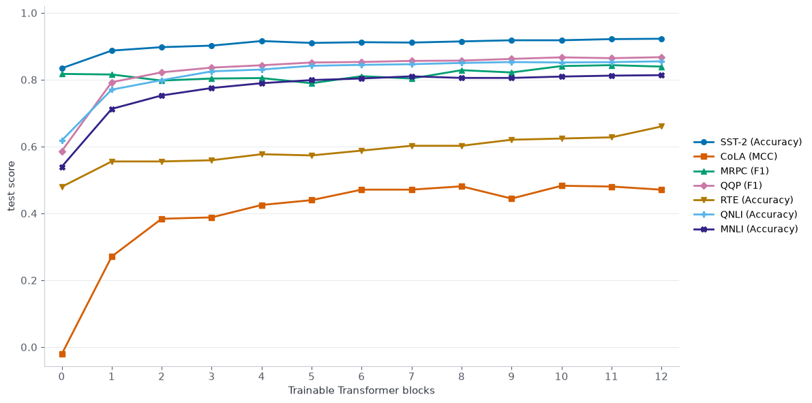
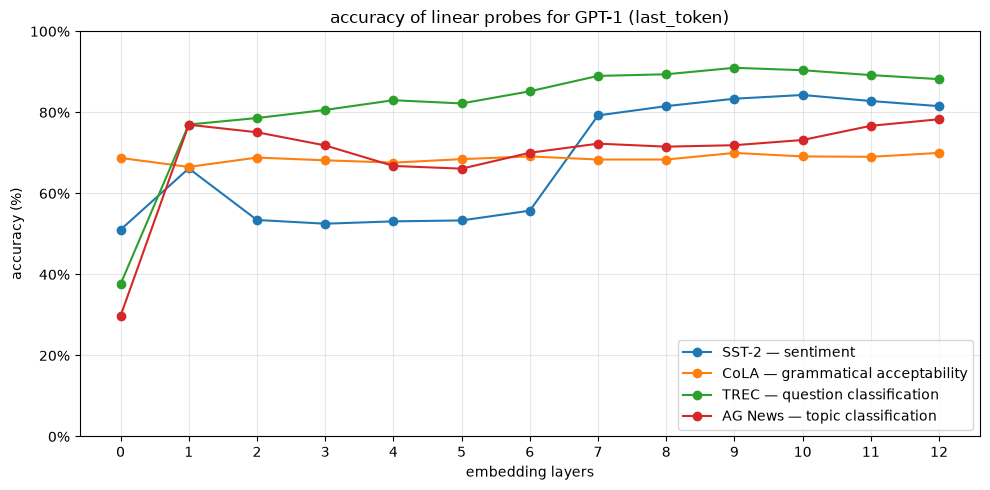
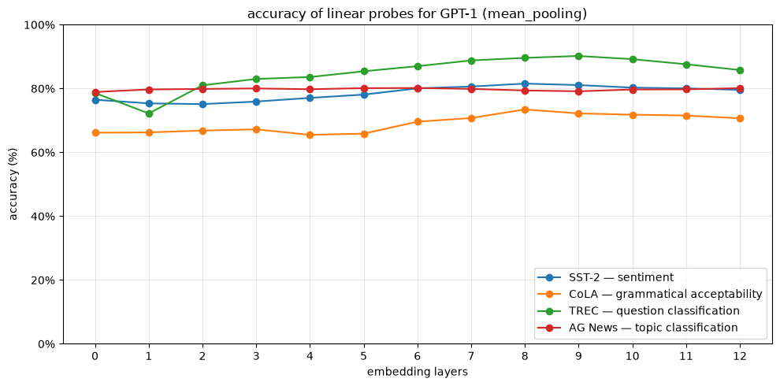

### Note : 

This is an essay about the article [_Improving Language Understanding by Generative Pre-Training._](https://cdn.openai.com/research-covers/language-unsupervised/language_understanding_paper.pdf) OpenAI report (GPT-1). 

After considering interesting elements of this publication, we propose few experiments as a "follow up / educationnal questions". They are described (in French) in the last part. 

### Pourquoi l'article est-il intéressant ? 

Cet article publié en 2018, quelques mois après l'essor de l'architecture transformer, est pionnier dans le domaine du NLP. En effet, c'est l'un des premiers qui présente la méthode utilisée comme base de développement des LLMs modernes : le pré-entrainement non-supervisé à l'aide de transformer. 

Les auteurs montrent qu'en entrainant un réseau de neurones (architecture transformer) sur un corpus de langage extrêmement large et varié de manière non-supervisée, le modèle est capable d'apprendre des caractéristiques inhérentes au langage naturel (grammaire, syntaxe, sémantique). Contrairement aux précédents modèles utilisés (LSTM par exemple), l'architecture transformer, l'attention permet de capturer des interactions à grande portée. La où les modèles statistiques classiques du langage (type word2vec) calculaient des embeddings au niveau de chaque mot, le transformer adapte au fil des couches les embedddings, en considérant le contexte d'une phrase voire d'un paragraphe complet. 

Une fois ces "embeddings" appris, on a une représentation de nos tokens qui prend en compte le contexte implicite (par exemple, on sait que le verbe s'applique au sujet). On peut ensuite rajouter un autre petit modèle, entraîné de manière supervisée à réaliser une tâche précise comme de la classification de texte, répondre à des questions ou déterminer la similarité sémantique entre deux phrases. 

Après avoir défini l'architecture : 
- Transformer avec multi-head self attention de 12 blocs 
- Hidden dimension : 768 
- Layer norm à chaque bloc

la phase de pré-entraînement est assez aisée : il s'agit de maximiser la log-likelihood où l'on cherche à prédire le token suivant sachant le contexte (i.e. les $k$ tokens précédents) : 

$$L_1(\mathcal{U}) = \sum_i \log P(u_i \mid u_{i-k}, \ldots, u_{i-1}; \Theta)$$

Il reste deux limites importante : l'étape de fine tuning reste nécessaire. A cette époque on a pas une seule grande machine capable de répondre à des tâches de langages très différentes comme on est capable d'avoir avec les LLMs de 2026. 

### En quoi est-il surprenant ? 

Malgré la complexité et diversité des tâches proposées, il se trouve que l'approche proposée fonctionne étonnamment bien. 

1) Supervised Fine tuning - Une loss intéressante

Il se trouve que lors de la phase de fine-tuning supervisé pour une tâche précise, on conserve dans la loss une partie de $L_1(\mathcal{U})$ : cela signifie que l'on veut à la fois s'adapter à la task spécifique, le tout sans perdre la structure syntaxique/sémantique du langage apprise auparavant. Cela permet apparemment d'augmenter en généralisation ainsi que converger plus vite (ce n'est pas du tout évident)

2) Simplicité du modèle ajouté 

L'étape de fine-tuning est en réalité un modèle très simple : il s'agit d'une simple couche linéaire à laquelle on ajoute un $softmax$. 
Attention : contrairement à LoRA, ici on ne gèle pas les paramètres du modèle pré-entrainé; les auteurs fine-tunent l'entièreté du transformer + couche linéaire. Cela ne montre pas encore la capacité générale du transformer à créer des représentations ultra efficientes pour des tâches très diverses. 

3) Les tâches sur lesquelles on teste sont très différentes 

- Natural langage inference : implication, contradiction entre deux phrases 
- Réponse à des questions / raisonnement basique : choisir une réponse à partir de texte disponible
- similarité sémantique 
- classification de texte

De plus, contrairement aux modèles précédents, les auteurs soulignent que l'architecture n'est pas modifiée entre les différentes tâches : modulo quelques adaptations des données en entrée, elle peuvent être traitées par le modèle pré-entrainé. C'est un gros gain de flexibilité et d'adaptabilité !

4) Des résultats probants sur les transformers et le pre-training

Les auteurs obtiennent des résultats SOTA sur quasiment toutes les tâches de traitement de langage naturel (9/12 datasets évalués), à la fois sur des petits et des grands datasets. 
Intéressant à noter : le gain sur STS-B (petit dataset) est assez énorme en comparaison à d'autres modèles (+10%  par rapport à Multi-Task BiLSTM) alors que sur le dataset plus large SNLI, le gain est un peu plus marginal. Cela permet-il d'appuyer l'effet du pré-entrainement ? 
La partie ablation argumente justement en ce sens : le même benchmark avec la même architecture mais sans pré-entrainement fait baisser assez drastiquement l'accuracy sur toutes les tâches (notamment STS-B ou le dataset est petit). De plus, l'architecture Transformer est justifiée puisqu'elle surperforme un LSTM sur toutes les tâches, à l'exception de MRPC. 

5) Des débuts d'idées de "scaling laws" et d'interprétabilité

Dans la partie <u>Analysis</u>, les auteurs ont des considérations sur les lois d'échelles qui arriveront plus tard notamment en 2022 avec [chinchilla scaling laws](https://arxiv.org/pdf/2203.15556). Ils remarquent que l'accuracy d'une tâche augmente avec nombre de blocs d'attention dans le transformer. Cela veut dire que même sans entrainement sur le dataset, le modèle parvient à contextualiser des idées au fil des blocs d'attention. 

Pour savoir si le modèle pré-entrainé apprend des vrais concepts linguistiques comme la notion de phrase "positive" ou "négative", les auteurs ont fait des expériences en ajoutant le token "very" après la phrase qu'ils veulent tester et regardent la distribution de probabilité du prochain token entre "positif" et "négatif". Pareil pour RACE, ils proposent différentes réponses au LLM et regardent celle qui a la plus grande likelihood. 

###  Des exercices pédagogiques pour mieux comprendre

1) Sur le fine-tuning

On fait écho au point 2) : à quel point le modèle pré-entrainé génère des représentations générales ? Pour tester cela, on pourrait faire la comparaison suivante : on fine tune en gelant les poids des $k$ premiers blocs d'attention, en augmentant $k$, jusqu'à fine-tuner exclusivement une couche linéaire à la fin. 

Arriver à obtenir des résultats corrects sur des benchmarks variés où l'on fine-tune moins de paramètres montrerait vraiment l'utilité du pre-training et sa capacité à créer des représentations du langage. 

On a fine-tuné sur sept tâches sur les datasets complets en suivant le protocole du papier initial :
 - trois époques 
 - batchsize 32 
 - $\lambda = 0.5$
 
 L'abscisse représente le nombre de blocs entraînés, à $k=0$ on entraîne seulement une couche linéaire alors qu'à $k=12$ on fine tune tout le transformer GPT-1. 
La concavité des courbes suggère que l'adaptation est de moins en moins rentable : entraîner le dernier bloc apporte déjà un gain important sur QQP, QNLI et MNLI, puis chaque bloc supplémentaire améliore plus progressivement les résultats. Une partie du calcul effectué par les blocs préentraînés peut donc être réutilisée sans modification tout en gardant une performance plus que raisonnable. 

Le besoin d'adaptation dépend cependant de la tâche. Sur SST-2, la tête seule obtient déjà 83,5 % d'accuracy, contre 92,3 % pour le modèle complet : le sentiment est en partie accessible dans la représentation préentraînée, mais le fine-tuning conserve un gain substantiel. Sur CoLA, le MCC de la tête seule est pratiquement nul, puis atteint environ 0,47 avec six blocs entraînés. RTE continue également à bénéficier d'une adaptation plus profonde ; sa tête seule reste sous la baseline majoritaire, d'environ 52,7 % d'accuracy.

Attention : sur des petits datasets, il y a surement des effets d'overfitting. Plus on fine-tune de blocs d'attentions, plus on a de paramètres à entraîner (jusqu'à 116 millions pour le modèle complet). Cela peut aussi expliquer pourquoi on atteint des plateaux assez rapides. 

2) Sur l'interprétabilité 

Pour mieux comprendre la contextualisation des embeddings à l'aide du mécanisme d'attention, on peut essayer d'étudier couche par couche la capacité du modèle à détecter des concepts de langage (typiquement le positif/négatif). Pour cela, on peut faire comme dans l'article avec des méthodes basées sur la log-likelihood ou la distribution de probabilité du prochain token; mais on peut aussi regarder des outils comme le "linear probing". On fait une forward pass dans le modèle pré-entrainé d'une phrase positive ou négative. A chaque layer $l$, on récupère un vecteur $h^{(l)}$ : soit le dernier token, soit par mean-pooling. On réalise une regression logistique à chaque couche (avec la même séparation train/test) pour classifier si la phrase est positive ou négative, puis on observe l'accuracy de celle ci au fil des couches. 
Si cette dernière augmente avec $l$, cela indique que la propriété étudiée devient plus facilement accessible au classifieur linéaire dans la représentation choisie.

Pour mean-pooling, on observe qu'une très légère augmentation de l'accuracy au fil des couches. Cela veut dire que l'embedding des mots sans attention suffit déjà à séparer ssez correctement les tâches proposées. Cela est assez surprenant et décevant. 

En revanche, pour last-token, on a une grosse augmentation entre l'embedding de base et ceux contextualisés : c'est assez logique, à la couche 0, on a seulement accès à l'embedding du dernier token qui ne contient pas d'information pour la tâche à classifier. Au fil des blocs, l'attention fait son travail et contextualise la phrase : on observe une augmentation de l'accuracy jusqu'à obtenir des performances similaires à mean-pooling
Avec le dernier token, SST-2 progresse surtout à partir des couches 7 à 10, et TREC atteint environ 90 % dans les couches supérieures.

3) Sur l'hyper-paramètre $\lambda$

Faire une ablation sur $\lambda$ : à quel point ajouter le $LM$ (language modeling) objective est il pertinent ? Les auteurs présentent leur résultats avec $\lambda = 0.5$ et $\lambda = 0$, mais ne discutent pas des accuracy et convergence pour une grille de $\lambda > 0$. 

